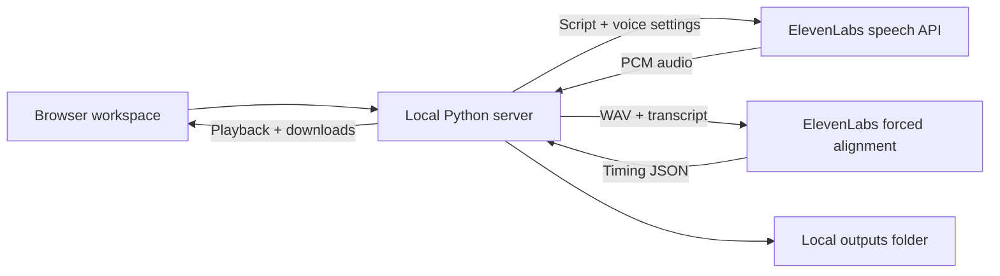

<div align="center">

# VOCUY

### Words in. Voice out.

A local voiceover studio for ElevenLabs: uncompressed WAV audio,<br>
word-level timing and ready-made After Effects compositions.

[](https://github.com/nazarkursant/vocuy/actions/workflows/tests.yml)


[](LICENSE)

[Quick start](#quick-start) · [Workflow](#your-first-voiceover) · [Privacy](#privacy) · [Development](#development)

</div>


VOCUY brings script entry, voice controls, audio playback and alignment exports
into one browser window. The app runs on your computer with **Python alone**: no
package installation, frontend build, database or hosted backend to configure.

> **Local interface, cloud generation.** An ElevenLabs API key and internet
> connection are required. Your script and audio are sent to ElevenLabs for
> synthesis and alignment. This is an unofficial community tool.

## What you can do

| | |
| --- | --- |
| **Produce clean audio** | Export uncompressed, mono, 16-bit WAV at 24 kHz or 44.1 kHz. |
| **Get precise timing** | Download the raw forced-alignment JSON with word and character timestamps. |
| **Shape the delivery** | Adjust stability, similarity, style, speed and speaker boost. |
| **Choose your voice** | Load saved voices from ElevenLabs or paste a voice ID. |
| **Keep a local library** | Name projects, add episode IDs, preview audio and revisit recent exports. |
| **Recover a partial export** | Retry failed alignment using the saved WAV without generating speech again. |
| **Build a conversation** | Give three speakers independent voices and settings; review messages and generate one WAV per turn. |
| **Build editor timelines** | Export to After Effects (JSX), Premiere Pro (XML) or DaVinci Resolve (Python) with audio, word markers and optional subtitles; reuse static recordings across batch sequences. |
| **Animate talking mouths** | Switch mouth images in time with each voice in After Effects, driven by an editable sound-to-mouth table. |

The interface includes Multilingual v2, Flash v2.5 and Turbo v2.5 model options.
Voice, model and format availability depend on your ElevenLabs account.

## Quick start

You need **Python 3.9 or newer**, a modern browser and an ElevenLabs API key.

```sh
git clone https://github.com/nazarkursant/vocuy.git
cd vocuy
python3 server.py
```

On Windows, run `py -3 server.py` instead. You can also download the repository
using **Code → Download ZIP**, extract it, and use a launcher:

| Platform | Launch |
| --- | --- |
| macOS | Double-click `Launch VOCUY.command`. If needed, run `chmod +x "Launch VOCUY.command"` first. |
| Windows | Double-click `Launch VOCUY.bat`. Install Python with the launcher or “Add Python to PATH” enabled. |
| Linux | Run `python3 server.py` from the project folder. |

The app opens your browser at **http://127.0.0.1:8765**. If that port is occupied,
it chooses a free local port and prints the address in the terminal.
Keep the terminal open while working; press **Ctrl+C** to stop the app.

## Your first voiceover

1. **Name the export.** Add a project name and an optional episode or scene ID.
2. **Connect ElevenLabs.** Paste your API key, then select **Load voices** or enter
   a voice ID manually. The app does not save the key in browser preferences.
3. **Set the voice.** Choose a model and adjust the voice controls.
4. **Choose an audio format.** Select 24 kHz or 44.1 kHz WAV.
5. **Paste your script.** The app accepts up to 10,000 characters per generation;
   provider limits may be lower for a particular model.
6. **Choose a destination folder**, or enter its full path and select **Use path**.
7. **Generate WAV + JSON.** Audio and timing JSON save to that folder. Listen in the browser, download the files, or use
   **Open outputs** to find them on disk.

Generation makes a speech request followed by a forced-alignment request.
ElevenLabs usage charges apply. Its [speech API documentation](https://elevenlabs.io/docs/api-reference/text-to-speech/convert)
currently requires **Pro or higher for 44.1 kHz PCM/WAV**. The app does not silently
change your selected sample rate.

If alignment fails, the completed WAV stays available. Select **Retry** to align
that recording again; this makes another alignment request, but no new speech
request.

## Your files

### Multi-voice conversations

1. Select **Multi voice**. Set the voice ID, model, delivery settings and audio
   format independently in the **Voice 1**, **Voice 2** and **Voice 3** tabs.
2. Paste the conversation. Unnumbered paragraphs separated by a **blank line**
   alternate Voice 1 → Voice 2 → Voice 1. A single newline stays with the same
   speaker. For explicit speakers, start each turn with `1.`, `2.` or `3.`:

   ```text
   1. Hi, how are you?
   2. Good! Is Alex joining?
   1. Yes, here he is.
   3. Hello, everyone!
   ```

   Numbered turns can be on consecutive lines or separated by blank lines. Label
   every turn when using numbers. The labels are removed from the spoken text.
3. Select **Prepare speech** to review compact messages showing the number,
   voice name and text. Click a message before generation to edit it. The script
   folds away and the message list scrolls independently, keeping the timeline
   and destination controls on screen. **Edit script** returns to the source.
   Preparation is local and makes no ElevenLabs requests.
4. **Choose a destination folder**, or enter an existing folder's full path and
   select **Use path**. Generation is disabled until a folder is selected.
5. Select **Generate messages**. Each turn generates separately, in order, using
   its speaker's settings. WAV files are saved directly in the selected folder,
   with names such as `voiceover_001_voice_1.wav`, `voiceover_002_voice_2.wav`.
6. Use **Play all messages** below the messages to listen in order. The active
   message is highlighted and scrolls into view. Click a message or timeline
   segment to start there, or use the seek bar to choose a time.
7. Hover or keyboard-focus a generated message to reveal its **regenerate** icon
   and pencil icon. Regenerate replaces only that message's playback. Its new file gets a suffix such as
   `_take_02.wav`; previous files are preserved. Current settings in the assigned
   voice's tab apply to the new take. Failed timing can be retried separately.

The batch continues while the local server is running, even if the browser tab
closes. Reloading restores the latest generated conversation. Re-select the
destination and enter the API key again after a reload before generating another
take. Unsubmitted edits are not saved. The conversation limit is 10,000 characters
and 200 messages. Only the voices used by your messages need valid voice IDs.

Each message still makes a speech request and a forced-alignment request, with
the same usage charges as single-voice generation. WAV files are copied to the
selected folder; alignment JSON, transcripts and local playback copies remain in
the app's history. No ZIP is created.

### CSV batch mode

Select **Batch**, choose a voice and import a UTF-8 CSV with **Choose CSV** (or
paste the CSV). Two layouts are supported:

- **Columns (one row per video):** `video_id,intro,narration,outro`, or your own
  speech column names. Each row is a sequence; its speech columns play from left
  to right. `video_id` and optional `script_revision` are metadata and are not spoken.
- **Segments (one row per clip):** `video_id,segment_id,text`, with optional
  `script_revision`. Rows sharing a `video_id` form one sequence, in file order.

Examples: [segments CSV](examples/batch_segments.csv) and the shared intro/outro
files below.

#### Example preset: four-part explainer

The app also ships with a built-in preset for a short explainer series, included
as an example of a fixed batch structure. A CSV with the columns
`video_id,topic,what_is_it,how_to_use_it,cake_explanation` is recognised
automatically, and each row becomes four clips in `topic`, `what`, `usage`,
`cake` order (a title, a definition, a practical use and an everyday analogy).
Additional columns are ignored. See the [explainer CSV](examples/batch_topics.csv).

When this preset is detected, an optional **Explainer preset: omit the opening
“Let's explain it with cake.”** checkbox appears. It removes only that leading phrase from the
analogy clips, for series that use a prerecorded hook instead. It is off by
default. If your series has a different shape, use the columns layout above.

Quoted commas, multiline text and
UTF-8 BOMs are supported. IDs use letters, numbers, underscores or hyphens;
unsafe filenames, empty text and duplicate video/segment pairs are rejected.
The batch limit is 1,000 clips and 500,000 spoken characters, with at most 10,000
characters in any one clip. A 100-row explainer CSV produces 400 clips.

After importing, select **Static columns** in the app. Each selected column is
generated once per batch and its recording is reused in every sequence preview.
Repeat identical text in that column, or enter it in one row and leave the rest
blank. Conflicting texts are rejected before generation. In segment-format CSVs,
the choices correspond to segment IDs and reuse applies wherever that segment occurs.

Five-row examples:

| CSV | Select as static | Recordings generated |
| --- | --- | --- |
| [Shared intro](examples/batch_shared_intro.csv) | `intro` | 6 |
| [Shared outro](examples/batch_shared_outro.csv) | `outro` | 6 |
| [Shared intro and outro](examples/batch_shared_intro_outro.csv) | `intro`, `outro` | 7 |

**Prepare batch** shows the sequence, message and recording counts. Review
or edit the messages, choose a destination folder, then generate. The selected
folder becomes the batch root. Every take is saved as a review candidate in
numbered passes, so retries never overwrite earlier audio:

```text
<chosen folder>/
├── scripts/VIDEO_001/VIDEO_001_topic.txt
└── audio/candidates/
    ├── pass_01_initial/VIDEO_001/
    │   ├── VIDEO_001_topic.wav
    │   ├── VIDEO_001_topic.txt
    │   ├── VIDEO_001_topic.alignment.json
    │   ├── VIDEO_001_topic.words.tsv
    │   └── VIDEO_001_topic.candidate.json
    └── pass_02_retry/VIDEO_001/
        └── VIDEO_001_topic.wav  (+ the new take's sidecars)
```

Each regenerated clip uses the next available pass, preserving earlier files.
Static recordings are stored once at `audio/shared/pass_01_initial/<column>.wav`,
with the same timing and candidate sidecars; shared script copies are stored in
`scripts/shared/`. Shared candidate metadata lists the sequences using the clip.
Regenerating a static message creates one new take and updates every sequence
that uses it. Editing its text likewise updates all its occurrences.
The root `scripts/` copy preserves the initial text; the text beside each
candidate records what that take actually says. Candidate metadata includes
voice settings, revision and attempt, but no API key. Candidates are marked
`REVIEW_PENDING`; the app does not automatically approve them or copy them into
an approved-assets folder. Batch mode covers CSV preparation, generation,
playback and individual retries; reviewing and approving candidates is left to
your own workflow. No pronunciation substitutions run automatically.

Use **Preview** to choose one sequence or listen to all sequences in order.
The same timeline and hover controls work in Batch mode. Multi voice and Batch
keep separate voice settings and restore their own latest generated sessions.

### After Effects compositions

After generating, choose **Resolution**, **Subtitles** and **Frame rate** beside
**Create an After Effects Composition**. Defaults are **1080 × 1920 vertical**,
**Words**, and **30 fps**. Landscape and square presets are also available.
Subtitles can show individual **Words**, short **Phrases**, or be **Off**.
Every option includes word markers on the audio layers, so audio and valid word
timings are required even with subtitles off. Retry missing alignment first.

Click the button to save a `.jsx` script in the selected destination folder.
The result also offers **Download JSX**. Existing scripts are preserved with
numbered filenames. Exporting uses saved recordings and makes no ElevenLabs
requests. To use an older recording, choose **Recent exports → Use**; it opens
as a single voiceover. Multi voice and Batch export their current generated session.

In After Effects, select **File → Scripts → Run Script File**, choose the JSX,
then save your project. The script creates a new VOCUY folder in the current
project with imported audio and these compositions:

| Mode | Composition contents |
| --- | --- |
| One voice | One composition with the chosen recording, word markers and optional subtitles. |
| Multi voice | One composition with messages in playback order, distinct speaker label colors, and matching speaker identities in colored subtitles. |
| Batch | One composition per `video_id`, with its clips in CSV order. A 100-video batch creates 100 compositions. Shared/static recordings are imported once and reused. |

The Batch preview selection does not limit the export: all sequences are included.
Segment-format CSV rows with the same `video_id` share one composition. Active
takes follow playback; if a new take failed before producing audio, the previous
playable take is used with its original timings and speaker. Regenerate edited
messages before exporting. A partial batch with missing audio or timing is blocked.

Audio uses the WAV's exact duration; subtitles use frame boundaries and editable
Source Text keyframes. Very fast words sharing a frame are displayed together.
Phrases split at punctuation, pauses, six words or approximately 42 characters.
All subtitle text is uppercase and centered in the composition, with an anchor
point that stays in the middle of the visible text as captions change.
Subtitle text is white in One voice and Batch, and colored by speaker in Multi
voice. Timeline label colors use After Effects' label presets and can look
different if those preferences have been customized.

The script references WAV files rather than embedding them. Keep those files
available. References prefer the original exported take, with local history as
a fallback. WAV paths inside the script's destination folder are also stored
relative to the script, so you can move that folder together. Missing audio is
reported before the script changes the project. No additional Python packages,
Node.js runtime, or After Effects extension is needed; Python writes the
[ExtendScript file that After Effects runs](https://helpx.adobe.com/after-effects/desktop/automate-in-after-effects/automate-animation/scripts.html).

### Lip-sync mouths in After Effects

Open **Lip sync · After Effects** at the bottom of the export panel to make a
talking mouth from still images. This is a separate script from the main export:
run both if you also want subtitles and word markers.

1. Choose a folder of mouth images for **Voice 1**. In Multi voice, Voices 2 and
   3 can use their own folders, or leave them empty to share Voice 1's mouths.
2. Choose **Create lip-sync composition**. It uses the resolution and frame rate
   selected above, plus the saved audio and character timings, so it costs no credits.
3. In After Effects, run the `_lipsync.jsx` file with **File → Scripts → Run Script File**.

Each voice gets a null named `Voice N - … - Mouth control`. Its mouth layer and
its audio clips are parented to it, so moving or scaling the null moves that
character's mouth. The null's **Mouth pose** slider holds the image number for
each frame; edit those hold keyframes to retime or replace any pose. Every mouth
folder becomes a `Mouth poses` precomp in which image N sits on frame N − 1.

#### The mouth table (`mouth_map.csv`)

Put a `mouth_map.csv` in the mouth folder to say which images show each mouth
shape. Open it in Excel, Numbers or Google Sheets. List several images in the
`poses` cell (separated by spaces) to rotate between them for variety. Name
images by number (`14`), file name (`mouth_14_lower_lip_tucked_upper_teeth.png`)
or name without extension. Only images in the table are used, so a reference
sheet in the same folder is ignored. Only the `rest` row is required: a missing
shape borrows a similar one, for example `oo` → `oh` → `ah` → `rest`.

| Shape | Sounds | Clay pack poses |
| --- | --- | --- |
| `rest` | Silence, pauses of 0.15 s or more | 01 |
| `mbp` | M, B, P | 01 |
| `fv` | F, V, PH | 11 |
| `th` | TH | 12 |
| `l` | L | 12 |
| `ee` | EE, EA, IE, Y | 06, 08 |
| `eh` | E, I, AI, AY | 07, 02 |
| `ah` | A | 04, 03 |
| `wide` | A held 0.2 s or longer | 05, 04 |
| `uh` | U as in *but* | 03, 02 |
| `oh` | O, OW, OA, AW, AU, OI | 09 |
| `oo` | OO, OU, EW, W, WH, QU | 10 |
| `r` | R, ER as in *work* | 10 |
| `sz` | S, Z, X, soft C | 08, 06 |
| `ch` | CH, SH, J, soft G | 08, 10 |
| `tdn` | T, D, N, K, G, H, NG and other letters | 02, 07, 03 |

The included `Clay_Mouth_Poses_12_Transparent_512` folder has this table and a
pose spec in its `README.md`. Its poses share one upper-lip line, so only the
jaw moves between images. A folder without a table but with 20 images numbered
in the original `mouth_01…mouth_20` order uses a built-in 20-pose table.

English words are looked up in the bundled [CMU Pronouncing
Dictionary](https://github.com/cmusphinx/cmudict) (126,000 words, including many
names), so *Friday* opens on "FRAI" and *time* moves through AH → EE. Other
words, such as names, transliterations and Cyrillic text, are read from the
spelling with continental vowels (*i* as EE, *u* as OO). Sounds are spread over
each word's ElevenLabs timestamps. This is a visual approximation, not phoneme
recognition from the audio. Shapes appear one frame before their sound, change at most
about 12 times per second (every 2 frames at 24–30 fps), and lip closures for
M/B/P are kept when sounds crowd together. The script references the images
rather than embedding them; keep the mouth folder available.

### Premiere Pro and DaVinci Resolve

Choose **Editor → Premiere Pro** or **DaVinci Resolve** above the export settings.
Both use the same resolution, frame rate, subtitle and word-marker data as
After Effects. In Multi voice, each speaker gets its own audio track (A1–A3).
Batch mode creates one sequence or timeline per `video_id`, and shared recordings
are imported once. Both editors place clips on whole frames. Back-to-back clips
may lose less than one frame of trailing silence.

With subtitles on, one `.srt` file per sequence is saved in a
`…_subtitles` folder next to the export. Keep that folder with the WAV files.

**Premiere Pro** — the export is a Final Cut Pro 7 XML file
(`…_premiere.xml`). In Premiere, choose **File → Import** and select the XML.
It creates a bin with sequences at the chosen size and frame rate. Each audio
clip has one marker per word and a speaker label color. Premiere does not read
captions from XML. Import each SRT and drag it onto its sequence at `00:00`.

**DaVinci Resolve 18+** — the export is a Python script (`…_resolve.py`).
Open a project, then choose **Workspace → Console → Py3** and enter the
`exec(open(r'…', encoding='utf-8').read())` line shown after export.
You can also copy the script into Resolve's `Fusion/Scripts/Edit` folder and run it
from **Workspace → Scripts**. Resolve needs a Python 3 install for its scripting.
The script adds a VOCUY bin with audio, timelines and subtitles. Each clip has
word markers and speaker colors. The script imports each SRT and places it on a
subtitle track. If that version of Resolve can't place it at the right time, the
script prints a message; drag the SRT from the Subtitles bin to the timeline start.
Resolve can only change a project's frame rate before its first timeline. If an
existing project uses a different rate, the script stops without changes. Use a
new project or export at the project's rate. Messages appear in the Console.

### Local history

New recordings are grouped by project, episode, and recording/voice, with numbered
takes under `outputs/recordings/`:

```text
outputs/
└── recordings/
    └── Documentary/
        └── Episode 01/
            └── Voiceover - Narrator/
                ├── Take 01/
                │   ├── documentary_01.wav
                │   ├── documentary_01_alignment.json
                │   ├── transcript.txt
                │   ├── metadata.json
                │   └── metadata_internal.json
                └── Take 02/
```

Multi-voice folders include the message number and speaker, such as
`Message 002 - Voice 2 - Narrator`. Batch folders use the video and segment names;
reused clips use `Shared - intro - Narrator`. Projects without an episode use
`No episode`. Repeated generations get the next available take number, so earlier
files remain intact. Existing ID-named folders stay where they are to preserve
audio links in After Effects; history, playback, retries and exports read both
layouts. Files in your selected destination keep their existing export structure.

The filename comes from the project name and optional ID. The JSON preserves
ElevenLabs' alignment response, including `words` and `characters` with timing
values in seconds. Metadata records export status and settings; it excludes the
API key. A failed job may have only some of these files.

The browser shows the nine most recent exports. All saved job folders remain
available on disk until you remove them. The entire `outputs/` directory is ignored
by Git.

## Privacy

- **Local server:** listens on `127.0.0.1`, with request-host and origin checks.
- **Credentials:** used in memory; excluded from preferences and job metadata.
  Submitted keys and known local paths are redacted from error messages.
- **Browser preferences:** project name, episode ID, voice and synthesis settings
  for all profiles are remembered, along with the latest Multi voice and Batch
  session identifiers. The API key and draft script are excluded.
- **Local files:** submitted scripts, generated audio, alignment and metadata are
  saved unencrypted in `outputs/` for history and retries.
- **External processing:** ElevenLabs receives your script for speech generation
  and your script plus generated WAV for forced alignment.

Read [Privacy and data flow](docs/PRIVACY.md) for storage details and cleanup
instructions. VOCUY is intended for local use and has no user-authentication
system.

## How it works



The backend uses Python's `ThreadingHTTPServer`. The frontend is plain HTML, CSS
and JavaScript. One generation, conversation batch or alignment retry runs at a
time. Conversation jobs run sequentially; individual messages can be retried.

```text
server.py                 Local HTTP server, ElevenLabs requests and export jobs
conversation.py           Speaker parsing, destination selection and safe exports
production.py             CSV preparation and per-video candidate exports
after_effects.py           Audio/timing validation and After Effects export data
editors.py                 Premiere Pro XML, DaVinci Resolve script and SRT export
recordings.py              Readable local recording folders and legacy lookup
templates/after_effects.jsx  After Effects composition builder
lipsync.py                 Mouth tables, sound-to-shape rules and lip-sync keys
data/cmudict.txt.gz        CMU Pronouncing Dictionary (BSD-style license in data/)
templates/lip_sync.jsx     After Effects lip-sync builder (nulls, mouths, audio)
templates/davinci_resolve.py DaVinci Resolve timeline builder
static/playback.js        Ordered playback and timeline position handling
static/                   Browser interface, styles and JavaScript
tests/test_app.py         Offline tests with mocked provider responses
docs/                     Interface preview and privacy documentation
.github/workflows/        Cross-platform tests and JavaScript syntax check
Launch VOCUY.command  macOS launcher
Launch VOCUY.bat      Windows launcher
```

## Development

Run the tests without an API key or paid requests:

```sh
python3 -m unittest discover -s tests -v
```

The suite checks WAV output, speaker parsing, independent voice settings, ordered
exports, regeneration, alignment retries, input validation, credential redaction
and local HTTP behavior. It uses a temporary localhost port and temporary
output files. GitHub Actions runs it on Linux, macOS and Windows.

If Node.js is installed, check the browser script with:

```sh
node --check static/app.js
node --check static/playback.js
node --test tests/test_playback.js tests/test_export_ui.js
```

See [CONTRIBUTING.md](CONTRIBUTING.md) for the development workflow.

## Troubleshooting

| Problem | What to try |
| --- | --- |
| Python is not found | Install Python, reopen the terminal, then use `python3` on macOS/Linux or `py -3` on Windows. |
| macOS blocks the launcher | Start with `python3 server.py` from Terminal, or use Finder's **Open** action for a trusted download. |
| The browser does not open | Copy the local URL printed in the terminal. |
| “Local server unavailable” | Relaunch the app and keep its terminal window open. |
| API key or permission error | Check the key's permissions and your ElevenLabs account access. |
| A voice is missing | Paste its voice ID manually. Voice loading retrieves up to 400 saved voices. |
| 44.1 kHz is unavailable | Check your plan or explicitly select 24 kHz for the next generation. |
| Alignment failed | Use **Retry** on the saved export; the WAV is preserved. |

## ElevenLabs API references

- [Text to speech](https://elevenlabs.io/docs/api-reference/text-to-speech/convert)
- [Forced alignment](https://elevenlabs.io/docs/api-reference/forced-alignment/create)
- [Search saved voices](https://elevenlabs.io/docs/api-reference/voices/search)

Built with the ElevenLabs API. This project is not affiliated with or endorsed by
ElevenLabs.

## License

Released under the [MIT License](LICENSE). Copyright (c) 2026 nazarkursant.
