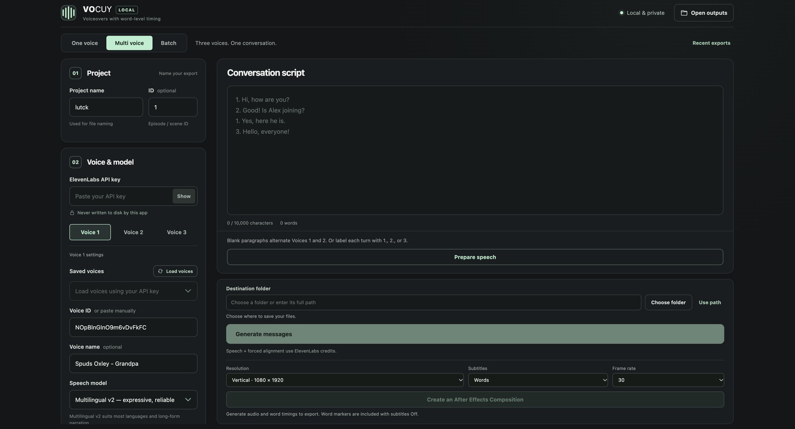
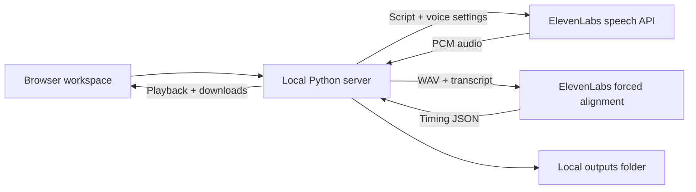

<div align="center">

# VO Studio

### Words in. Voice out.

A local ElevenLabs workspace for narration, uncompressed WAV audio,<br>
and precise word and character timestamps.

[](https://github.com/nazarkursant/11labs-fast-api-interface/actions/workflows/tests.yml)


[](LICENSE)

[Quick start](#quick-start) · [Workflow](#your-first-voiceover) · [Privacy](#privacy) · [Development](#development)

</div>



VO Studio brings script entry, voice controls, audio playback and alignment exports
into one browser window. The app runs on your computer with **Python alone**: no
package installation, frontend build, database or hosted backend to configure.

> **Local interface, cloud generation.** An ElevenLabs API key and internet
> connection are required. Your script and audio are sent to ElevenLabs for
> synthesis and alignment. This is an unofficial community tool.

## What you can do

| | |
| --- | --- |
| **Produce clean audio** | Export uncompressed, mono, 16-bit WAV at 24 kHz or 44.1 kHz. |
| **Get precise timing** | Download the raw forced-alignment JSON with word and character timestamps. |
| **Shape the delivery** | Adjust stability, similarity, style, speed and speaker boost. |
| **Choose your voice** | Load saved voices from ElevenLabs or paste a voice ID. |
| **Keep a local library** | Name projects, add episode IDs, preview audio and revisit recent exports. |
| **Recover a partial export** | Retry failed alignment using the saved WAV without generating speech again. |

The interface includes Multilingual v2, Flash v2.5 and Turbo v2.5 model options.
Voice, model and format availability depend on your ElevenLabs account.

## Quick start

You need **Python 3.9 or newer**, a modern browser and an ElevenLabs API key.

```sh
git clone https://github.com/nazarkursant/11labs-fast-api-interface.git
cd 11labs-fast-api-interface
python3 server.py
```

On Windows, run `py -3 server.py` instead. You can also download the repository
using **Code → Download ZIP**, extract it, and use a launcher:

| Platform | Launch |
| --- | --- |
| macOS | Double-click `Launch VO Studio.command`. If needed, run `chmod +x "Launch VO Studio.command"` first. |
| Windows | Double-click `Launch VO Studio.bat`. Install Python with the launcher or “Add Python to PATH” enabled. |
| Linux | Run `python3 server.py` from the project folder. |

The app opens your browser at **http://127.0.0.1:8765**. If that port is occupied,
it chooses a free local port and prints the address in the terminal.
Keep the terminal open while working; press **Ctrl+C** to stop the app.

## Your first voiceover

1. **Name the export.** Add a project name and an optional episode or scene ID.
2. **Connect ElevenLabs.** Paste your API key, then select **Load voices** or enter
   a voice ID manually. The app does not save the key in browser preferences.
3. **Set the voice.** Choose a model and adjust the voice controls.
4. **Choose an audio format.** Select 24 kHz or 44.1 kHz WAV.
5. **Paste your script.** The app accepts up to 10,000 characters per generation;
   provider limits may be lower for a particular model.
6. **Generate WAV + JSON.** Listen in the browser, download the files, or use
   **Open outputs** to find them on disk.

Generation makes a speech request followed by a forced-alignment request.
ElevenLabs usage charges apply. Its [speech API documentation](https://elevenlabs.io/docs/api-reference/text-to-speech/convert)
currently requires **Pro or higher for 44.1 kHz PCM/WAV**. The app does not silently
change your selected sample rate.

If alignment fails, the completed WAV stays available. Select **Retry** to align
that recording again; this makes another alignment request, but no new speech
request.

## Your files

Each generation gets its own folder under `outputs/`:

```text
outputs/
└── <job-id>/
    ├── documentary_ep-01.wav
    ├── documentary_ep-01_alignment.json
    ├── transcript.txt
    ├── metadata.json
    └── metadata_internal.json
```

The filename comes from the project name and optional ID. The JSON preserves
ElevenLabs' alignment response, including `words` and `characters` with timing
values in seconds. Metadata records export status and settings; it excludes the
API key. A failed job may have only some of these files.

The browser shows the nine most recent exports. All saved job folders remain
available on disk until you remove them. The entire `outputs/` directory is ignored
by Git.

## Privacy

- **Local server:** listens on `127.0.0.1`, with request-host and origin checks.
- **Credentials:** used in memory; excluded from preferences and job metadata.
  Submitted keys and known local paths are redacted from error messages.
- **Browser preferences:** project name, episode ID, voice and synthesis settings
  are remembered. The API key and draft script are excluded.
- **Local files:** submitted scripts, generated audio, alignment and metadata are
  saved unencrypted in `outputs/` for history and retries.
- **External processing:** ElevenLabs receives your script for speech generation
  and your script plus generated WAV for forced alignment.

Read [Privacy and data flow](docs/PRIVACY.md) for storage details and cleanup
instructions. VO Studio is intended for local use and has no user-authentication
system.

## How it works



The backend uses Python's `ThreadingHTTPServer`. The frontend is plain HTML, CSS
and JavaScript. One generation or alignment retry runs at a time.

```text
server.py                 Local HTTP server, ElevenLabs requests and export jobs
static/                   Browser interface, styles and JavaScript
tests/test_app.py         Offline tests with mocked provider responses
docs/                     Interface preview and privacy documentation
.github/workflows/        Cross-platform tests and JavaScript syntax check
Launch VO Studio.command  macOS launcher
Launch VO Studio.bat      Windows launcher
```

## Development

Run the tests without an API key or paid requests:

```sh
python3 -m unittest discover -s tests -v
```

The suite checks WAV output, alignment retries, input validation, credential
redaction and local HTTP behavior. It uses a temporary localhost port and temporary
output files. GitHub Actions runs it on Linux, macOS and Windows.

If Node.js is installed, check the browser script with:

```sh
node --check static/app.js
```

See [CONTRIBUTING.md](CONTRIBUTING.md) for the development workflow.

## Troubleshooting

| Problem | What to try |
| --- | --- |
| Python is not found | Install Python, reopen the terminal, then use `python3` on macOS/Linux or `py -3` on Windows. |
| macOS blocks the launcher | Start with `python3 server.py` from Terminal, or use Finder's **Open** action for a trusted download. |
| The browser does not open | Copy the local URL printed in the terminal. |
| “Local server unavailable” | Relaunch the app and keep its terminal window open. |
| API key or permission error | Check the key's permissions and your ElevenLabs account access. |
| A voice is missing | Paste its voice ID manually. Voice loading retrieves up to 400 saved voices. |
| 44.1 kHz is unavailable | Check your plan or explicitly select 24 kHz for the next generation. |
| Alignment failed | Use **Retry** on the saved export; the WAV is preserved. |

## ElevenLabs API references

- [Text to speech](https://elevenlabs.io/docs/api-reference/text-to-speech/convert)
- [Forced alignment](https://elevenlabs.io/docs/api-reference/forced-alignment/create)
- [Search saved voices](https://elevenlabs.io/docs/api-reference/voices/search)

Built with the ElevenLabs API. This project is not affiliated with or endorsed by
ElevenLabs.

## License

Released under the [MIT License](LICENSE). Copyright (c) 2026 nazarkursant.
